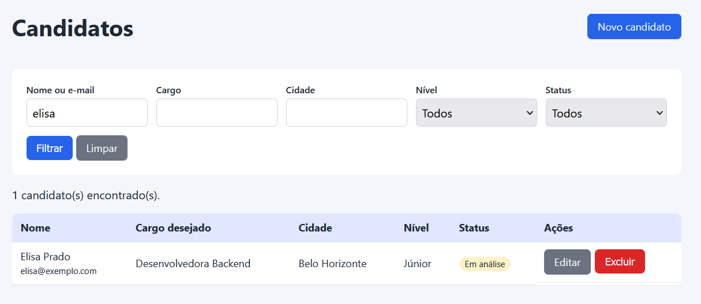

# TRIAHub

Banco de talentos para equipes de RH: cadastre candidatos e encontre perfis por nome, cargo, cidade, nível e status.

Projeto de portfólio construído em Laravel como MVP.

## Funcionalidades

- Cadastro, edição e exclusão de candidatos (CRUD)
- Validação de dados, com e-mail único
- Busca e filtros combinados: nome ou e-mail, cargo, cidade, nível e status
- Acompanhamento do status do candidato: novo, em análise, aprovado ou descartado



## Tecnologias

- PHP 8.2
- Laravel 12
- MySQL
- Blade

## Como rodar

Requisitos: PHP 8.2 ou superior, Composer e MySQL.

```
git clone https://github.com/JoanaCampos04/TRIAHub.git
cd TRIAHub
composer install
copy .env.example .env
php artisan key:generate
```

Crie um banco chamado `triahub` e confira no `.env`:

```
DB_CONNECTION=mysql
DB_HOST=127.0.0.1
DB_PORT=3306
DB_DATABASE=triahub
DB_USERNAME=root
DB_PASSWORD=
```

Depois:

```
php artisan migrate
php artisan serve
```

Acesse http://127.0.0.1:8000.

## Estrutura principal

- `app/Models/Candidato.php`: model e opções de nível e status
- `app/Http/Controllers/CandidatoController.php`: CRUD e filtros
- `resources/views/candidatos/`: telas de listagem, cadastro e edição
- `database/migrations/`: estrutura da tabela de candidatos

## Próximos passos

- Autenticação para recrutadores
- Habilidades por candidato
- Paginação e ordenação
- Upload de currículo

## Autora

Joana Campos